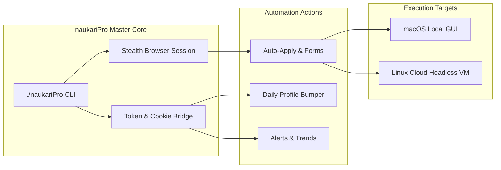

# 🚀 NaukariPro: Autonomous AI Career Suite & Job Application Engine

[](https://www.python.org/)
[](LICENSE)
[]()
[]()

**NaukariPro** is an enterprise-grade career automation engine and recruiter visibility maximizer designed specifically for **Naukri.com**. It automates the entire job search lifecycle—from daily Resdex search ranking boosts to 1-click batch applications, automated screening questionnaire handling, and market intelligence tracking.

---

## 🌟 Core Features & Modules

### 1. ⚡ Auto-Apply Engine
* **Batch Multi-Apply:** Automatically selects and applies to up to 5 matching roles simultaneously from recommended feeds.
* **Chatbot Screening AI:** Automatically parses and answers employer screening questions (Notice Period, Total YOE, Relevant YOE, Ex-employee status, Current/Expected CTC) using verified facts.
* **Local Excel Tracker:** Logs every application, timestamp, vacancy URL, and submission status into `Naukri_Live_Application_Tracker.xlsx`.

### 2. 🔔 Instant Job Alerts
* Filters openings posted within the last 24 hours across target tech stacks and compensation bands.
* Notifies you instantly so you apply within the critical **First 10 Applicants** window.

### 3. 📈 AI-Enhanced Profile (Resdex Booster)
* **The "Daily Bump":** Executes programmatic daily micro-touches to maintain the coveted **`Last updated - Today`** freshness status, keeping your profile at the top of recruiter search queues.
* **Resdex Completeness Multiplier:** Verifies and scores your profile against Naukri's 11 core ranking dimensions.

### 4. 🕵️ Hidden Job Opportunities
* Uncovers early-stage, zero-applicant listings and direct HR recruiter postings before they hit broad distribution.

### 5. 📄 AI Resume Maker
* Programmatically builds single-page, ATS-optimized PDFs tailored with verified metrics, clean typography, and zero parsing errors using ReportLab.

### 6. 🎯 AI Interview Prep Tools
* Curated technical question banks, architectural trade-off blueprints, and strategic salary negotiation scripts for high-CTC discussions.

### 7. 🧠 In-Demand Skill Insights
* Analyzes enterprise and GCC hiring demands across Azure Databricks, PySpark, Delta Lake, Kafka, and Kubernetes.

### 8. 📊 Industry Hiring Trends
* Tracks salary distributions, active hiring hubs (Bengaluru, Hyderabad, Pune, Remote), and compensation multiples across Global Capability Centers.

---

## 🏗️ Architecture & Anti-Bot Evasion



* **Akamai & Bot Evasion:** Injects stealth JavaScript properties (`navigator.webdriver` removal, realistic plugins, mock touchpoints) to bypass bot detection.
* **Session Persistence:** Retains long-lived session state and authentication tokens, eliminating repeated captcha prompts.
* **Cross-Platform:** Runs natively on macOS (with optional AppleScript browser bridging) and headless on Linux cloud instances (Oracle Cloud, AWS, GCP, Azure).

---

## 🚀 Quick Start Guide

### 1. Clone & Set Up Virtual Environment

```bash
git clone https://github.com/lavkushry/NaukariPro.git
cd NaukariPro

python3 -m venv .venv
source .venv/bin/activate
pip install -r requirements.txt
playwright install chromium
```

### 2. Configure Environment

Copy `.env.example` to `.env` and enter your credentials:

```bash
cp .env.example .env
```

Edit `.env`:
```ini
NAUKRI_EMAIL=your_email@example.com
NAUKRI_PASSWORD=your_naukri_password
HEADLESS=true
DAILY_APPLICATION_LIMIT=20
```

---

## 💻 CLI Commands

The master launcher `./naukariPro` provides an intuitive CLI:

```bash
# Display help and module list
./naukariPro --help

# Run daily automated routine (Bump profile + Apply + Log)
./naukariPro daily

# Bump profile recency to 'Last updated today'
./naukariPro bump

# Run automated job applications
./naukariPro auto-apply

# Scan instant job alerts
./naukariPro alerts

# Uncover hidden / early-access vacancies
./naukariPro hidden-jobs

# Generate fresh ATS Resume PDF
./naukariPro resume-maker

# Launch AI interview preparation bank
./naukariPro interview-prep

# View in-demand skill insights
./naukariPro skill-insights

# View hiring trends & salary benchmarks
./naukariPro hiring-trends
```

---

## ☁️ Running Remotely on a Linux Server

NaukariPro runs headlessly on any remote Linux instance (Ubuntu ARM64 / x86_64).

### Execute via SSH Heredoc:

```bash
ssh -i ~/.ssh/your-key.key -o BatchMode=yes ubuntu@your-server-ip 'bash -s' <<'EOF'
set -euo pipefail
cd /home/ubuntu/Resume
./naukariPro daily --headless
EOF
```

### Or using the included remote wrapper:

```bash
./run_on_linux.sh daily --headless
```

---

## ⏰ Automated Daily Scheduling

### macOS LaunchAgent:
Install the included background agent to run `./naukariPro daily` automatically every morning at 09:15 AM IST:

```bash
./install_schedule.sh
```

---

## 📄 License

This project is licensed under the [MIT License](LICENSE).
